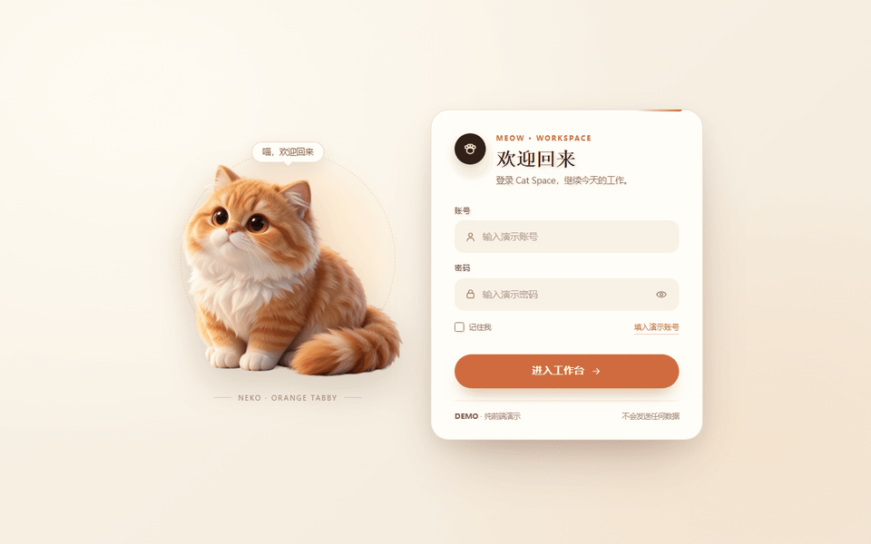

# Cat login page · 小猫登录演示页

纯前端登录演示页；橘猫为AI根据我的提示词和参考图绘制，可以放心使用。橘猫使用 20 帧单图序列（5×4，单格 768×768）。



> 上图为GIF演示图，可能有点卡，具体效果看实际部署。

## 设计与交互

- 奶油色纸感背景 + 暖橘品牌色，衬线大标题搭配无衬线正文
- 圆角登录卡、图标输入框、密码显示切换、记住我、演示账号一键填入
- 鼠标在页面移动：猫头按上、下、左、右方向转动
- 聚焦「账号」：猫看向右侧
- 聚焦「密码」：猫先转向左侧，再扭头闭眼显示「我不看」
- 输入框失焦、窗口失焦：回到正面待机
- 登录只在前端演示，不连接后端

演示账号：`demo` / `meow123`，也可以直接点「填入演示账号」。

## 文件

```text
cat-login-page/
├── index.html
├── assets/
│   ├── catseq20-sprite-fix.webp   # 5列×4行，20帧，单格768×768
│   └── catseq20-fallback.webp     # 首帧静态兜底
├── preview.gif                    # README 动图演示（5秒 / 20fps）
├── preview.png                    # 静帧封面
└── README.md
```

## 本地打开

直接双击 `index.html` 即可；图片使用相对路径 `assets/...`。

## 接入自己的登录接口

在 `index.html` 底部脚本中，把 `form.addEventListener('submit', ...)` 里的演示分支替换成你的 `fetch` / 表单提交逻辑即可。猫的精灵图、帧序列和鼠标交互都与登录逻辑独立，不需要改动。

需要改品牌名或文案，直接搜索这些位置：

- 页面标题：`<title>Cat Space · 小猫登录演示</title>`
- 卡片标题：`欢迎回来`
- 副标题：`登录 Cat Space，继续今天的工作。`
- 演示账号：脚本中的 `demo` 和 `meow123`

配色集中在 `:root` 的 `--paper`、`--card`、`--accent`、`--ink` 等变量里，改一处即可整体换色。

## 个人使用随便折腾，请勿用于商业目的。
